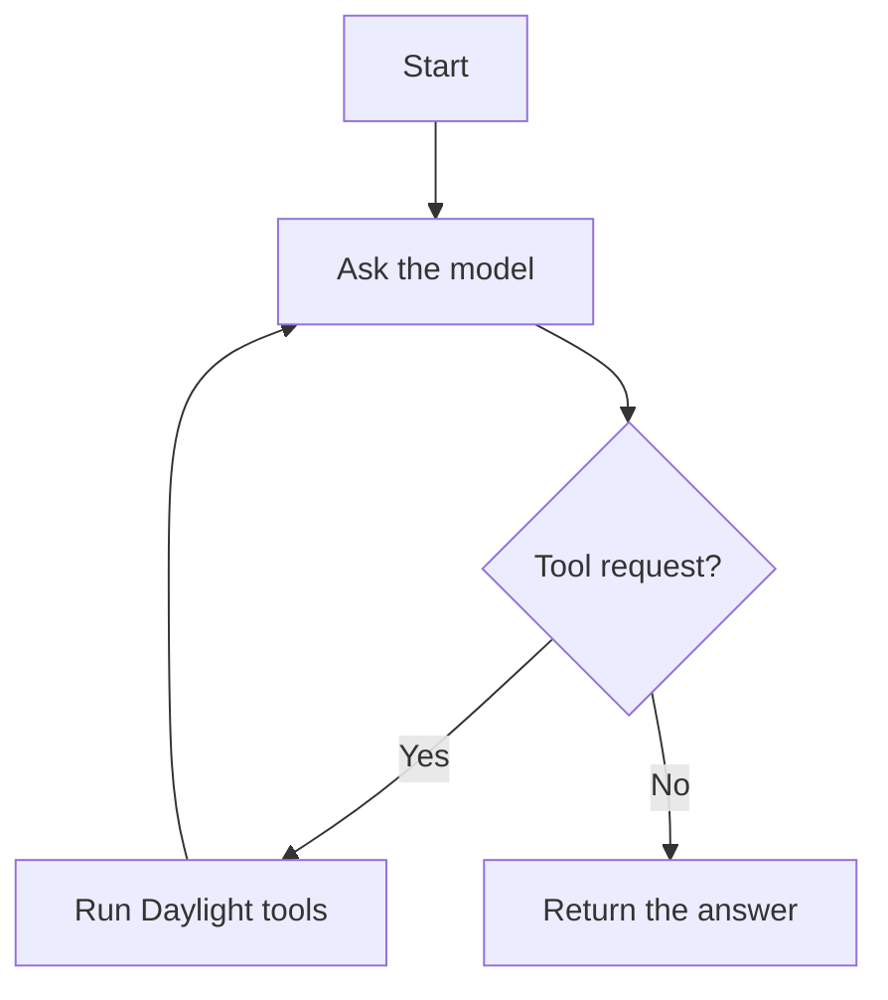

# Daylight assistant: concepts, real chat flow, and the MCP follow-up

**Current implementation:** the in-app model selector, Groq-first model catalog, Gemini option, authenticated LangGraph chat route, owner-scoped project/task tools, and database-backed conversation history are in the codebase. The assistant migration has been applied to the configured local database. Actual model requests still need provider keys in the backend environment; Gemini also needs its optional adapter installed. The separate MCP server is the next phase and is not implemented yet. This document explains the ideas first, then traces the current code.

**Scope:** start with the in-app assistant for project questions, task creation, and task movement. After that, expose the same actions through an MCP server for external clients. Payments and credits are out of scope.

## Part 1 — Concepts from scratch

### Start with the ordinary Daylight app

Daylight already has a Next.js frontend, a FastAPI backend, services that implement project and task actions, and a database. When the user clicks **Create task**, the browser sends an HTTP request to FastAPI. FastAPI checks who is signed in, then a service such as `task_service.create_task(...)` validates the project and saves the task.

The assistant follows the same security boundary. The model does not connect to PostgreSQL, receive a database session, or run SQL. It can only ask our backend to call a small set of functions we explicitly provide.

### What LangChain does

LangChain is the adapter between our Python code and AI model providers. Different providers have different request formats and ways to describe callable functions. LangChain gives the app common pieces—chat models, messages, and tools—so the Daylight actions do not have to be rewritten for each provider.

LangChain does not replace FastAPI, our existing services, SQLAlchemy, authentication, or the database. It connects those parts to a model.

### What a tool is, and how the model chooses one

A **tool** is an ordinary backend function with a name, a description, and a defined set of arguments. For example, `create_task(project_name, title, ...)` describes the task-creation capability to a model. The argument types form a schema: the model is told which values the function expects.

When Daylight sends a user's message to a model, it also sends the available tool descriptions. The model can answer normally, or return a structured request such as “call `list_projects`.” The model only proposes the call. LangGraph runs the function in our backend, and the model sees its result before it writes its final reply.

The model never chooses the signed-in user's ID. The tool function captures that ID from FastAPI's authenticated request. Every lookup and write is scoped to that user and goes through Daylight's existing service functions.

### What LangGraph is, and why this project uses it

LangGraph runs the agent as connected steps. A **node** is one step, such as asking the model or running tools. An **edge** says what comes next. A **conditional edge** checks the latest result and chooses a route.

The current graph is intentionally small:



A normal loop could perform this same first version. LangGraph makes the model/tool loop and its shared message state explicit. That helps us learn the concepts and leaves a clear place for future steps such as asking the user to confirm a sensitive action or handling a multi-step request. We are using a graph for that structure, not because every chatbot needs a graph library.

### What “state” means in LangGraph

**State is the graph's working notebook for one request.** In our graph it is a `messages` list. Each node reads the current list and adds its result. For example:

| Moment | What gets added to state |
| --- | --- |
| User sends a message | A human message with the user's request |
| Model asks for a tool | An AI message containing a structured tool call |
| Tool runs | A tool message containing the real result |
| Model writes back | An AI message with the reply and no tool call |

The messages list matters because the model needs to see both the original request and the tool results. It can use a project ID returned by `list_projects` when making a later `create_task` call in the same graph run.

There are two kinds of “remembering” here. LangGraph state exists while one request is being processed. Daylight's database stores the conversation after the request, so the history panel can show it on a later visit. For a new message, our route loads the saved user/assistant messages and uses them to start the next graph run. We are not using a LangGraph checkpointer yet; database history is separate from a graph checkpoint.

### What MCP is, and how it differs from a LangChain tool

**MCP** stands for Model Context Protocol. It is a standard way for an external AI application to discover and call tools offered by another application.

A LangChain tool is used by **Daylight's own in-app agent**. An MCP tool is exposed to an **external AI host**, such as Claude Code. With MCP, the external host uses its own model and conversation loop. Daylight receives a requested action, checks the external caller's identity, and runs the same Daylight action. MCP does not call the in-app LangGraph.

So the shared design is: two entry points, one set of owner-scoped Daylight actions.

### What FastMCP does

FastMCP is a Python framework for creating an MCP server. We register Python functions as MCP tools, and it handles the MCP protocol messages and tool schemas. It does not decide which tool an external model should use, and it does not automatically know which Daylight user is calling. Before external use, Daylight still needs a real MCP authentication and identity-mapping design.

The in-app chat is being built first. FastMCP, its auth configuration, and the `/mcp` mount are not in the current implementation.

### Models and effort controls

A **model** reads the message and can propose tool calls. **Effort** is a provider-specific preference for how much reasoning the model uses. It does not mean “run more graph nodes.” The same Low / Medium / High selection has to be translated to each provider's actual option.

The current catalog has two provider options:

| Choice | Model ID | When it is enabled | Effort setting |
| --- | --- | --- | --- |
| Groq (default) | `openai/gpt-oss-20b` | Backend has `GROQ_API_KEY` | Automatic, Low, Medium, High |
| Gemini | `gemini-3.5-flash-lite` | Backend has `GEMINI_API_KEY` or `GOOGLE_API_KEY` | Automatic, Low, Medium, High |

Groq is selected by default whenever it is configured. Gemini is available as a second choice; if Groq is not configured but Gemini is, Gemini becomes the only available choice. Groq uses LangChain's OpenAI-compatible adapter pointed at Groq's endpoint. Gemini uses LangChain's native Google adapter so its tool-call continuation data is preserved through a multi-step graph run. The Gemini integration is an optional dependency group; the UI keeps Gemini disabled until that adapter and a key are both present. The browser never receives either API key.

## Part 2 — One real chat request, step by step

We will follow this exact request:

> create a task called “write launch email” in my Daylight project

The model's precise tool-call IDs and wording can vary. The order of responsibilities stays the same.

### Step 1 — What happens when the user sends the message

The `/daylight` component `frontend/src/app/(workspace)/daylight/_components/agent-workspace.tsx` reads the message, selected model, effort, and optional project context. It calls the `useSendAssistantMessage` mutation. That mutation calls `assistantApi.sendMessage` in `frontend/src/features/assistant/api.ts`:

```ts
sendMessage(input: AssistantChatInput) {
  return request<AssistantConversation>('/assistant/chat', {
    method: 'POST',
    body: {
      message: input.message,
      conversationId: input.conversationId,
      modelId: input.modelId,
      effort: input.effort,
      projectId: input.projectId,
    },
  });
}
```

The existing `request` helper sends the session cookie and CSRF header. FastAPI receives it at `POST /assistant/chat` in `backend/app/api/assistant.py`. The route depends on `get_current_user` and `require_csrf`, checks that the requested model is configured, and checks that the effort is supported by that model. The browser cannot bypass those checks by crafting its own request.

### Step 2 — Load this user's saved conversation and enter the graph

For an existing conversation, the route first loads it by both its ID and the authenticated user's ID. A conversation ID by itself is never proof of ownership. If the user continues with the same model, it restores that model's private graph trace. If they switch models, it rebuilds context from the visible saved user and assistant messages. The current user message is appended last.

If the user attached project context with the composer, the route verifies that project belongs to the signed-in user before passing the project's name and ID as context. That context helps the model understand “this project”; it does not itself cause a write.

The route calls `run_agent(...)` in `backend/app/assistant/graph.py`. That function creates a new state for this request:

```python
result = graph.invoke(
    {"messages": [SystemMessage(content=prompt), *messages]},
    config={"recursion_limit": 12},
)
```

The graph starts at the `assistant` node. `MessagesState` is the LangGraph state shape: it provides a `messages` list, and each node returns new messages to append to it.

### Step 3 — The graph asks the model whether a tool is needed

The backend model factory constructs the selected provider adapter and binds the Daylight tools to it. In `graph.py`, the model node is:

```python
def call_model(state: MessagesState) -> dict[str, list[BaseMessage]]:
    response = model.invoke(state["messages"])
    return {"messages": [response]}
```

For this request, the model needs to know which “Daylight” project belongs to the user. It can return a structured call to `list_projects`. LangGraph's `tools_condition` sees that the latest AI message has a tool call and routes state to the `tools` node. The condition chooses **whether** tools run; the model chooses **which** tool and its arguments.

### Step 4 — Run the tool against Daylight's existing services

The tools are declared in `backend/app/assistant/tools.py`. `build_tools(owner_id)` captures the authenticated user ID in the functions. It is never one of the model-visible arguments. Each tool opens its own short-lived database session.

For example, the model may first call:

```json
{"name":"list_projects","args":{}}
```

The tool calls `project_service.get_project_summaries(...)` and returns the user's projects. After seeing exactly one project named Daylight, the model may call:

```json
{"name":"create_task","args":{"project_name":"Daylight","title":"write launch email","priority":"none"}}
```

The `create_task` tool calls `create_task_action(...)` in `backend/app/assistant/actions.py`. That action resolves the exact project name, rejects missing or ambiguous matches, then calls the existing service:

```python
task = task_service.create_task(
    db,
    project.id,
    owner_id,
    TaskCreate(title=title, notes=notes, priority=priority),
)
```

The existing service checks that the project belongs to this user, assigns the task to its initial stage, and writes it. The model never sees a database session and cannot choose a different user's `owner_id`.

### Step 5 — Put the tool result into graph state

LangGraph's `ToolNode` executes the requested function. It appends a tool result to the same messages list. A success result includes the task ID, title, project name, and stage. The graph then routes back to `assistant`, and the model sees that result.

The model can now say the task was created because it has a tool result that confirms the save. If the project match is ambiguous or the tool returns an error, the model should ask the user to clarify or explain the failure instead.

### Step 6 — Stop when the model has a final answer

The model returns an ordinary assistant message such as:

> Created “write launch email” in Daylight, in To Do.

There is no tool call attached to that final message. `tools_condition` routes to the end of the graph. `run_agent` extracts the final message text and returns it to the FastAPI route.

### Step 7 — Save the conversation and show the reply

After the graph returns, `save_exchange(...)` writes the user's message and the assistant's answer to the owner-scoped conversation/message tables. A new conversation is created on the first successful turn. The selected model and effort are stored with it, and the user's optional project context is stored alongside their message.

The API returns the complete conversation, in camelCase JSON, for example:

```json
{
  "id": "conversation-uuid",
  "title": "create a task called ‘write launch email’ in my Daylight project",
  "modelId": "openai/gpt-oss-20b",
  "effort": "automatic",
  "messages": [
    {"id":"message-1","role":"user","content":"create a task called ‘write launch email’ in my Daylight project"},
    {"id":"message-2","role":"assistant","content":"Created ‘write launch email’ in Daylight, in To Do."}
  ]
}
```

The UI displays the user's message and Daylight's reply, moves the composer to the bottom of the conversation, and updates the project/task queries so the new task appears in the app. **New conversation** clears the active chat. **View history** loads saved conversations from `GET /assistant/conversations`; opening one fetches its messages from `GET /assistant/conversations/{id}`.

### What the database stores, and what it does not

The new `AssistantConversation` and `AssistantMessage` models live in `backend/app/models/assistant_conversation.py`. Their Alembic migration is `backend/migrations/versions/a8e31f4c92bd_assistant_conversations.py`; it has been applied to the configured local database. On another environment, run `uv run alembic upgrade head` after confirming the backend is pointed at the intended database.

The database saves visible user and assistant messages for history. It also keeps a private serialized graph trace for the currently selected model so the next request can continue with internal tool messages and provider-specific continuation data. The history API does not return this private trace to the browser. If the user switches models, the backend rebuilds context from the visible user/assistant messages instead of passing one provider's private trace to another provider. The graph trace is capped to recent turns; the database history remains available in the history panel.

### Backend setup

The Python dependencies are declared in `backend/pyproject.toml` and locked in `backend/uv.lock`. Install the default Groq/LangGraph stack with `uv sync`. If you plan to use Gemini, install its optional provider adapter with `uv sync --extra gemini`. Copy `backend/.env.example` to `backend/.env` and add your provider keys:

```text
GROQ_API_KEY=your-groq-key
GEMINI_API_KEY=your-gemini-key
```

Do not put either value in a `NEXT_PUBLIC_*` variable or commit actual keys. `GROQ_API_KEY` makes Groq the default. Gemini uses `GEMINI_API_KEY` or `GOOGLE_API_KEY`. If no provider key is configured, the models appear unavailable and Send remains disabled with a setup message.

Groq uses `reasoning_format="hidden"` because its reasoning models require a compatible output format for tool calling. Gemini's native adapter accepts the selected effort as its `thinking_level`. See the [LangChain Groq reference](https://reference.langchain.com/python/langchain-groq/chat_models/ChatGroq) and [LangChain Google GenAI reference](https://reference.langchain.com/python/langchain-google-genai/chat_models/ChatGoogleGenerativeAI) for provider-specific parameters.

## Part 3 — The MCP side (next phase)

The detailed execution plans are in [the MCP README](../mcp/README.md) and [the OAuth README](../oauth/README.md). They build on the actions and authenticated chat flow described above.

The same Daylight actions can later be exposed as MCP tools. That MCP work has **not** been implemented yet. The chosen plan uses Daylight-issued OAuth tokens after an interactive login and consent flow, so users can connect with a URL instead of copying credentials. The identity check must be implemented before exposing write actions outside the app.

### Step 1 — Register the shared actions with FastMCP

The planned MCP wrapper will call `list_projects_action`, `list_project_tasks_action`, `create_task_action`, and `move_task_action` from `backend/app/assistant/actions.py`. It will not call the in-app LangGraph route. A future MCP tool could have this general shape:

```python
from fastmcp import FastMCP

mcp = FastMCP("Daylight")

@mcp.tool
def create_task(project_name: str, title: str) -> dict:
    """Create a task in an authorized Daylight project."""
    # Resolve the authenticated MCP caller to a Daylight user first.
    # Then call the same owner-scoped action used by the in-app assistant.
    ...
```

The `...` is deliberate: Daylight's OAuth token verification and user resolver have not been implemented yet.

### Step 2 — What the external client does

An MCP-compatible client connects to Daylight and asks for the available tool schemas. Its own model may ask to call `list_projects`, then call `create_task` using the returned project name or ID. FastMCP validates the arguments and calls Daylight's wrapper. The wrapper resolves the verified caller to a Daylight user, and the shared action checks ownership before touching a project or task.

Claude Code (or another host) owns its own model and conversation. Daylight does not make a Daylight in-app chat-history entry for the external host unless we deliberately add a separate audit/history feature later.

### Step 3 — Mount and protect the MCP server

FastMCP can provide an ASGI application that FastAPI mounts at a route such as `/mcp`. The final mount must include Daylight OAuth token verification, lifespan handling, and deployment configuration. The code below is only the shape of that eventual integration; do not expose an unauthenticated MCP mount:

```python
mcp_app = mcp.http_app(path="/")
app = FastAPI(lifespan=mcp_app.lifespan)
app.mount("/mcp", mcp_app)
```

The current FastAPI app has no MCP mount. MCP is the follow-up after the authenticated in-app chat and shared action layer are running.

## The key relationship

For in-app chat, **LangGraph chooses** which LangChain tool to run. For MCP, an **external AI host chooses** which MCP tool to call. Both paths should end in the same owner-scoped Daylight actions and existing service functions.
