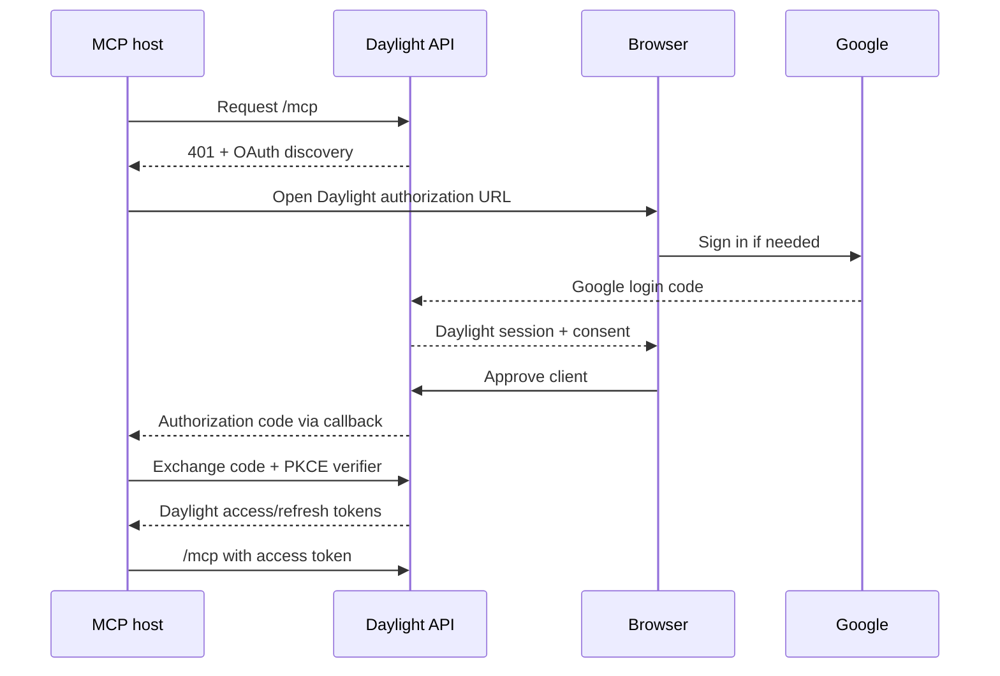

# Daylight OAuth: authorize Claude's website to use MCP

**Current implementation:** Daylight has email/password and Google sign-in, explicit Google linking, browser sessions, four owner-scoped assistant actions, a Daylight OAuth authorization server, a consent page, and a FastMCP `/mcp` endpoint. The public HTTPS Claude website connection has not been exercised yet. The implementation steps below describe the endpoint contract and how it was built.

**Goal and first target:** a person adds Daylight to **Claude's website** as a custom web connector by entering Daylight's public HTTPS `/mcp` URL, signs into Daylight if needed, and approves Claude's access. No manually copied bearer token. Claude receives Daylight-issued OAuth tokens in the background. Existing password/Google login and the in-app `/daylight` chat continue to work. Other MCP clients can follow once this first flow works.

For a standalone explanation of Google sign-in and Daylight browser sessions, read [the Google sign-in README](../google-sign-in/README.md) first.

## Part 1 — The two OAuth relationships

### Google signs a person into Daylight

Daylight is an **OpenID Connect client** of Google. The browser goes to Google, Google returns an authorization code to Daylight, and Daylight exchanges it server-side. Daylight verifies Google's **ID token**, finds or creates a Daylight `User`, and issues the *same kind of browser `AuthSession` cookie* that email/password login uses. The Google access token is not the credential that an MCP client uses to call Daylight. Use only `openid email profile` for login; Google API access and Google refresh tokens are not required for this scope. Google's authorization-code server flow and ID-token checks are documented [here](https://developers.google.com/identity/openid-connect/openid-connect) and [here](https://developers.google.com/identity/sign-in/web/backend-auth). 

### Daylight authorizes the external MCP client

Daylight also acts as an **OAuth authorization server** for external clients and as the **resource server** protecting `/mcp`. After the browser has a Daylight login session, Daylight asks whether to grant the named client access, issues a short-lived authorization code, and exchanges that code for *Daylight-issued* access and refresh tokens. The client sends the access token to `/mcp`; the server maps it to the Daylight user and calls the existing owner-scoped actions.

These are two different code exchanges:

| Exchange | Code sent to | Token recipient | Result |
| --- | --- | --- | --- |
| Google sign-in | Daylight's Google callback | Daylight backend | Verified Google identity and Daylight browser cookie |
| MCP client authorization | Client's registered callback | External MCP client | Daylight access/refresh tokens for `/mcp` |

The browser cookie answers “who is approving this connection?” The access token answers “who is making this later MCP request?” An OAuth authorization transaction temporarily ties a client request to that browser, but no new persistent MCP chat session is needed. Existing `AssistantConversation` history and Groq/Gemini keys are separate.

## Part 2 — What the user sees

### Signing into Daylight normally

On `/login` or `/register`, the person can click **Continue with Google**. The implemented callback verifies the response, creates a normal Daylight cookie session, and sends the browser to a validated frontend return path (usually the dashboard). `GET /auth/me` returns the Daylight user and CSRF token, as it does for password login. The OAuth implementation must add a server-bound continuation for pending Claude approval; the existing Google callback does not yet resume an OAuth authorization transaction.

The existing linking rule is deliberate: a new Google subject with an unused verified email creates a Daylight user; a matching email on a password account does **not** silently merge accounts. That person signs into the password account and links Google from Account settings. A Google-only account has no usable password. Google's stable `sub`, rather than the email address, identifies the linked Google account. These behaviors are already implemented and should be preserved.

### Adding Daylight as an MCP connection

1. On Claude's website, open **Customize → Connectors → Add → Custom → Web**; enter a connector name and `https://daylight-api.example.com/mcp` (illustrative URL). Claude must reach it from its cloud via public HTTPS or a supported tunnel; local `localhost:8000` by itself will not work.
2. Claude reviews detected authentication, offers **Sign in now** or **Sign in when needed**, and presents an OAuth client identity choice. For the first integration, use **Claude's published identity** if Daylight successfully validates it; otherwise use Claude's **Register automatically** option if Daylight implements compatible registration. A manually provisioned client is a fallback only if required by a verified compatibility issue. The host receives Daylight's OAuth challenge and discovers its authorization metadata.
3. Daylight checks its existing browser cookie. If absent, the person signs in with Google or email/password. Successful sign-in returns to the *pending authorization*, not the dashboard.
4. Daylight shows the host's verified name, requested permissions, and the current Daylight account. The person approves or denies.
5. On approval, Daylight redirects to the client's **validated registered redirect URI** with a short-lived authorization code and the client's `state`. The client exchanges the code with its PKCE verifier for Daylight tokens.
6. Claude retries `/mcp` with its access token, discovers the four tools, and can call them after the connector is enabled in a conversation. The person can later revoke this connection from their Daylight account.

Claude's current setup options and connection steps are documented in [Get started with custom connectors using remote MCP](https://support.claude.com/en/articles/11175166-get-started-with-custom-connectors-using-remote-mcp). The final Claude UI labels and supported identity method should be verified in the live integration test.

Google sign-in is an option for the browser step; a person already signed into Daylight need not visit Google again. A client can obtain access to Daylight only after Daylight authorizes it; Google's login response alone cannot be used as `/mcp` authorization.

## Part 3 — Planned endpoints and ownership

The names below are the proposed public contract. Keep OAuth protocol endpoints on the backend origin used in published metadata, even if the consent page itself is rendered by Next.js. A framework may supply some routes; match their public URLs to this contract and test the resulting discovery documents.

| Endpoint | Caller and purpose | Authentication / result |
| --- | --- | --- |
| `GET /auth/google/start` | **Existing:** browser starts Google login with a validated frontend `return_to` path | Generates short-lived state/nonce and redirects to Google; pending OAuth continuation still needs integration |
| `GET /auth/google/callback` | **Existing:** Google redirects with code or error | Verifies state/ID token, resolves user, sets Daylight session, redirects to validated frontend path; extend to resume pending approval safely |
| `POST /auth/google/link/start` | **Existing:** signed-in user starts explicit account linking | Daylight session + CSRF; binds link transaction to that user |
| `GET /auth/me`, `POST /auth/logout` | **Existing:** browser session API | Keep current behavior for both login methods |
| `GET /.well-known/oauth-protected-resource/mcp` | MCP client discovers the protected resource | Public metadata: canonical `/mcp` resource URL, Daylight issuer, supported scopes |
| `GET /.well-known/oauth-authorization-server` | MCP client discovers Daylight authorization endpoints | Public issuer, authorize/token endpoints, PKCE method, supported grants/scopes, and supported client identification/registration method |
| `GET /oauth/authorize` | Browser arrives from MCP host with client ID, redirect URI, scope, state, PKCE challenge, and resource | Validate request; require Daylight browser login; show consent or redirect to safe login continuation |
| `POST /oauth/authorize/decision` | Browser approves or denies pending transaction | Daylight session + CSRF + transaction binding; issue one-use code or redirect with `access_denied` |
| `POST /oauth/token` | Host exchanges authorization code or refresh token | No browser cookie/CSRF; validate client, code, redirect URI, resource, PKCE; issue/rotate Daylight tokens |
| `POST /oauth/revoke` | Client or server revokes OAuth token | Authenticated client as required by registration; revoke token family as appropriate |
| `GET /auth/connected-apps`, `DELETE /auth/connected-apps/{id}` | Account UI lists and disconnects a granted MCP client | Daylight session; CSRF on delete; owner-scoped grant revocation |
| `/mcp` | MCP host discovers/calls tools over Streamable HTTP | Daylight access token only; verify user, scope, audience/resource and expiry per request |

**Claude client identity:** Claude currently offers **Use Claude's published identity (Recommended)**, **Register automatically**, and **Use your own OAuth client**. The first implementation path is to validate Claude's published client identity using a Client ID Metadata Document if its actual authorization request and metadata conform to that method. Advertise metadata-document support only after the validator works; verify the HTTPS document, exact client ID and redirect URI, and bound client identity, with SSRF, size, and timeout limits. Test this against Claude before declaring the flow complete. If Claude's published identity cannot interoperate, support Claude's automatic registration with a controlled `POST /oauth/register`, update the authorization-server metadata accordingly, and test again. A manually configured OAuth client and its registered Claude callback are a documented fallback, not the target user experience. Never accept an arbitrary `redirect_uri` because Claude supplied it. See [Claude's connector setup](https://support.claude.com/en/articles/11175166-get-started-with-custom-connectors-using-remote-mcp) and [MCP client registration approaches](https://blog.modelcontextprotocol.io/posts/client_registration/).

**Discovery is public; user data is not.** An unauthenticated `/mcp` request returns `401` with a `WWW-Authenticate` link to protected-resource metadata. That metadata points to Daylight's authorization server. The consent page and metadata must not leak projects or user information. OAuth tool requests use bearer tokens, not the `AuthSession` cookie. See the [MCP Python SDK authorization guide](https://py.sdk.modelcontextprotocol.io/run/authorization/).

## Part 4 — Implementation sequence

### Fixed implementation decisions (do not leave these for a later planning pass)

Use the **standalone FastMCP package v4** (`fastmcp>=4,<5`) for the Streamable HTTP server, bearer-token verification, challenge and protected-resource metadata. Create `FastMCP("Daylight", auth=...)`, configure its remote OAuth provider with Daylight as the authorization server and a database-backed token verifier, and register the four tools with `@mcp.tool`. Use the existing FastAPI application for Daylight's authorization-server routes and the existing Authlib dependency for OAuth/PKCE protocol primitives; keep the authorization data in SQLAlchemy/PostgreSQL. Implement those routes in `app/oauth/` and `app/api/oauth.py`. FastMCP's [remote OAuth](https://gofastmcp.com/docs/servers/auth/remote-oauth) and [FastAPI integration](https://gofastmcp.com/docs/integrations/fastapi) guides describe the resource-server and mount pieces. If a package API has changed, adapt its import/signature while keeping this endpoint contract.

Use `BACKEND_PUBLIC_URL` as the one issuer origin and construct `resource = BACKEND_PUBLIC_URL + "/mcp"` exactly. Production must use HTTPS. The OAuth metadata and `/oauth/*` endpoints live on the same backend origin, outside the protected MCP mount. Do **not** put `daylight:read` in transport-wide `required_scopes`: a client granted only `daylight:write` must reach the transport so the write tools can enforce their own scope. Advertise both scopes in resource metadata, then check the specific tool's scope inside its wrapper. Every MCP request still requires a valid resource-bound Daylight bearer token. Grant both scopes at once for the initial Claude connection.

**Client identity for the first release:** accept a Client ID Metadata Document (CIMD) URL as the OAuth `client_id` and validate its published document, redirect URIs, and `client_id` before storing/displaying it. Use Claude's **published identity** option in Claude's website. Implement a strict outbound fetch: HTTPS only; public DNS/IP targets only at initial lookup **and after each redirect** (prefer disallowing redirects); bounded response bytes and timeout; JSON content; exact `client_id` equality; and exact redirect URI membership. Do not display an unverified name as if it were verified. Cache a validated document briefly but revalidate its redirect URI when an authorization begins. The fallback `POST /oauth/register` is a separate follow-up **only if the live Claude connection shows CIMD cannot work**; it is not a reason to stop building the primary flow. Publish `client_id_metadata_document_supported: true` only when that validator and the authorization routes are active.

**Required new database records:** `OAuthAuthorizationRequest` (random handle hash, browser-binding hash, client ID, validated redirect URI, original client `state`, requested scopes, exact resource, PKCE S256 challenge, expiry, consumed/decision status); `OAuthAuthorizationCode` (one-use code hash, request/grant IDs, client ID, redirect URI, resource, scopes, challenge, expiry/used time); `OAuthGrant` (user ID, client ID, display name, scopes, resource, created/revoked time); `OAuthToken` (hash of opaque access or refresh token, grant ID, user/client IDs, resource, scopes, kind, expiry, used/revoked time and refresh family ID). Create one Alembic migration after the existing Google migration `c4f92a7e310b`. Add indexed/unique token hashes and foreign keys, and use transactions or row locks for single-use codes and refresh rotation. Never store plaintext bearer/refresh tokens.

**Authorization request:** `GET /oauth/authorize` accepts `response_type=code`, `client_id`, `redirect_uri`, `scope`, `state`, `code_challenge`, `code_challenge_method=S256`, and `resource`. Reject missing or unsupported fields, a different resource, an unregistered redirect URI, unsupported scope, or invalid PKCE before creating the browser-bound pending record. If already logged in, render consent for this record. Otherwise redirect to the frontend `/login?oauth_continue=<opaque handle>` and set a short-lived, HttpOnly, SameSite=Lax browser-binding cookie on the backend. The handle alone never authorizes approval. Do not recreate the OAuth request from frontend query parameters.

**Login continuation:** both frontend password login and Google login preserve only `oauth_continue` through the login/register screens. After password login, navigate to `BACKEND_PUBLIC_URL + "/oauth/continue?request=" + handle` (full browser navigation so backend cookies are sent). For Google, extend `/auth/google/start` to accept a **server-validated pending request handle**, store it on the existing Google login transaction, and have its callback navigate to `/oauth/continue` after setting the normal Daylight cookie; otherwise retain today's ordinary dashboard redirect. `GET /oauth/continue` verifies the pending record, browser-binding cookie, expiration and current Daylight session, and renders consent. Invalid/expired requests get a local restart message; never redirect to a client URI until that URI has been validated. Login failure leaves the user on login with a safe retry path.

**Consent:** render a small Daylight-owned page showing the *validated* Claude client name, current account, and plain-language read/write permissions. `POST /oauth/authorize/decision` requires the Daylight session, existing CSRF check, pending handle and browser binding; approve writes a one-use authorization code and redirects to the validated client URI with `code` and the original `state`; deny redirects with `error=access_denied` and the original `state`. Consume the pending request atomically in either case. No bearer or refresh token goes through the browser URL. A frontend consent route is acceptable if it gets only a safe pending summary from the backend and sends its decision through the authenticated API; backend must still enforce every check.

**Token endpoint:** `POST /oauth/token` accepts form data. For `authorization_code`, validate client ID, exact redirect URI, exact resource, code expiry/single use, and S256 verifier before issuing a short-lived opaque access token and rotating refresh token for the grant. For `refresh_token`, validate client/resource/grant, consume the old refresh token atomically and issue replacements; a reused refresh token revokes its family. Restrict new scopes to those approved. Return standard OAuth errors, `Cache-Control: no-store`, and no token in logs. `POST /oauth/revoke` checks the presenting client's identity and revokes its token/grant as appropriate. `GET /auth/connected-apps` lists only the signed-in user's grants; `DELETE /auth/connected-apps/{id}` requires session + CSRF, checks ownership and revokes all of that grant's tokens. Browser logout by itself does not revoke a grant.

### Step 1 — Reuse completed Daylight sign-in; add an OAuth continuation

Google identity, one-use browser-bound login transactions, account linking, nullable password hashes, the frontend Google buttons, and regular Daylight sessions are already implemented. Keep that login path and its tests. The current `GET /auth/google/start` accepts only a sanitized **frontend** `return_to` path and `GET /auth/google/callback` redirects to that frontend path; neither currently knows how to resume a pending `/oauth/authorize` request.

Add a short-lived, server-stored OAuth authorization transaction **before** sending an unauthenticated person to `/login`. Bind an unguessable continuation handle to that transaction and the same browser; do not trust a raw `redirect_uri`, scope, or authorization query recovered from a frontend URL. On successful Google **or password** login, return to a safe frontend/backend continuation that resumes the server-stored transaction, checks the new Daylight session and expiry, and then shows consent. On cancellation, failed login, expiry, or a different browser, show a safe error/restart path without issuing a code. Preserve ordinary dashboard redirects for normal sign-in and existing Google account linking.

### Step 2 — Add Daylight's authorization server for MCP

Implement the Daylight authorization-server routes in FastAPI, using the installed Authlib dependency for OAuth and PKCE primitives. Use standalone FastMCP v4 for resource-server behavior. Do not implement cryptography from scratch. Google is an upstream login provider; Daylight issues its own opaque tokens bound to **Daylight `/mcp`** and a Daylight `User.id`.

Persist minimal authorization data with Alembic: client metadata/registration or a validated metadata reference, short-lived authorization transactions (user, client, redirect, scope, resource, challenge, expiry), one-use authorization codes stored as hashes, grants/connected apps, and hashed opaque access/refresh tokens or library-managed equivalent. Set explicit expiries, rotate refresh tokens, and revoke the affected token family on replay or disconnection. Separate Google login state from MCP authorization state; never put a raw token or client secret in a browser URL or database plaintext. A Daylight logout ends the browser session; it does not silently claim to revoke every authorized client. The account **Disconnect** action revokes that client's grant and tokens.

For the first tool set, define `daylight:read` for project/task listing and `daylight:write` for task creation/movement; **write does not imply read**. Claude needs both scopes to use all four tools. Advertise only the scopes that are enforced for each tool call. The consent page names the validated client and requested scopes, identifies the current Daylight account, and lets the user approve or deny. Validate `client_id`, redirect URI, exact resource, PKCE challenge/method, supported scopes, and transaction binding before issuing a code. Only redirect errors to a verified redirect URI; otherwise show a local error page. `POST /oauth/token` checks the code's client, redirect, resource, one-use status, expiry, and PKCE verifier before returning tokens with `Cache-Control: no-store`.

### Step 3 — Protect and mount `/mcp`

Create the MCP server with standalone FastMCP v4, register four wrappers, and build `mcp.http_app(path="/mcp")`. Mount it at `/` **after** the FastAPI routes, so both `/mcp` and `/.well-known/oauth-protected-resource/mcp` work at the backend root. Combine the FastMCP app lifespan with FastAPI's lifespan: mounted sub-applications do not start their own lifespan. Wire FastMCP bearer verification to Daylight's opaque access-token table; each credential keeps its own issued scopes so later approval cannot expand an older token. Reject browser cookies and Google tokens, enforce token resource and expiry on every request, then enforce read/write scope for the called tool. Translate the verified token's `User.id` into `owner_id` for the four wrappers around `backend/app/assistant/actions.py`. Do not expose `owner_id` as a model argument or pass MCP calls through LangGraph.

### Step 4 — Test the exact connection flow

Start with a local OAuth test client to exercise pending-authorization continuation through existing Google and password sign-in, consent, code exchange, refresh, revocation, invalid redirects, scope enforcement, and cross-user isolation without live provider credentials. Then use a public HTTPS test deployment or supported tunnel: in **Claude's website**, add a custom web connector with Daylight's `/mcp` URL, select the tested OAuth client identity option, follow its sign-in and approval prompts, and enable it in a conversation. Discover `list_projects`, `list_project_tasks`, `create_task`, and `move_task`; confirm changes in Daylight, token refresh, and disconnect. Record the observed Claude UI and any client-registration compatibility adjustments. The website reaches Daylight from Anthropic's cloud, so a local-only FastAPI URL is insufficient.

## Part 5 — Files, tests, and completion criteria

| Area | Expected files / changes |
| --- | --- |
| Existing login and OAuth continuation | Reuse `backend/app/models/google_identity.py`, `backend/app/services/google_auth_service.py`, `backend/app/api/google_auth.py`, password auth, and browser session helpers; extend login return handling to resume a pending consent transaction |
| Daylight OAuth server | `backend/app/oauth/` for issuer, Claude client validation/registration, authorization, token/grant storage and verification; `backend/app/api/oauth.py` for public and browser routes |
| MCP resource | `backend/app/mcp/` wrappers/authentication, `backend/app/main.py` mount; reuse `backend/app/assistant/actions.py` |
| Database and configuration | New Alembic migration(s), `backend/app/models/__init__.py`, `backend/app/config.py`, `.env.example`, `pyproject.toml`, `uv.lock` |
| Frontend | Extend existing `/login` and `/register` for safe pending-approval continuation, add `/account` connected-apps controls and a consent page, keep existing auth query invalidation |
| Tests | Keep existing Google login/link tests; add pending-continuation, authorization-code/PKCE and token-lifecycle tests, MCP HTTP identity/scope tests, frontend login/consent checks, and a Claude website connection check |

Acceptance cases: existing password and Google login/linking still work; either login method resumes the exact pending Claude consent in the same browser; invalid redirects, state, PKCE, resource, client identity, or scope are refused; codes work once; refresh rotation and disconnection work; one user cannot discover or modify another user's projects; read-only grants cannot create or move tasks; `/mcp` rejects a browser cookie, Google token, and expired or revoked Daylight token; the four shared actions behave as in `/daylight`.

**Done when:** Claude's website connects with Daylight's public `/mcp` URL, completes interactive sign-in/approval without a pasted token, and uses the four tools on the approving user's data. This requires reachable HTTPS (or a supported tunnel) and a Claude client identity method Daylight actually supports. Google sign-in is optional during approval when the person already has a Daylight session or chooses password login. Claude account/workspace permissions remain a separate prerequisite.
